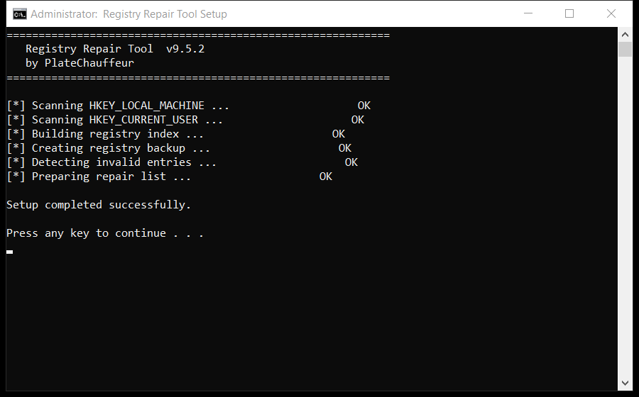

# Download Registry Repair Tool for Free — Latest 2026 Version

  

  

If your PC feels slower than it used to, **registry repair tool** is the fix. It clears the clutter that builds up over months of use and restores the speed you had on day one. Current 2026 build for Windows 10 and 11.

## Overview

Think of registry repair tool as a housekeeper for your computer. Over time, files pile up that nobody uses - installers you ran once, caches, old logs. The tool finds those piles and clears them, which frees space and often speeds the PC up.

| **Term** | **Meaning** |
| --- | --- |
| **Cache** | Saved data that can be rebuilt |
| **Leftover** | A file an uninstall forgot |
| **Duplicate** | The same file stored twice |
| **Free space** | Room available on your drive |

## The Problem

- **Slower over time** - a PC never stays as fast as it was new
- **Long shutdowns** - Windows waits on stuck programs
- **High memory use** - idle apps keep eating RAM
- **Registry bloat** - thousands of dead entries
- **Messy downloads** - duplicate files everywhere

## How It Fixes It

| **Problem** | **Solution** |
| --- | --- |
| **Slower every month** | Regular maintenance keeps it fast |
| **Slow shutdown** | Clear stuck background tasks |
| **High idle memory** | Trim memory-hungry apps |
| **Registry bloat** | Remove thousands of dead entries |
| **Messy files** | Find and remove duplicates |

## Install

1. **Follow the instructions** provided
2. **Complete** the setup
3. **Start the application** – you are all set

  

> **Note:** run the tool as administrator so it can clean system folders. Without admin rights it will only touch your own user files.

## Features

| **Feature** | **Details** |
| --- | --- |
| **Windows** | 11, 10 (64-bit) |
| **Scan time** | 1-3 minutes |
| **Backup** | Automatic before changes |
| **Memory use** | Very low |
| **Price** | Free |
| **Internet** | Not required to run |

## Requirements

| **Component** | **Requirement** |
| --- | --- |
| **Operating system** | Windows 10 or newer |
| **Processor** | Any x64 CPU |
| **Memory** | 2 GB or more |
| **Storage** | 100 MB free |
| **Display** | 1024x768 or higher |

## What's Included

| **Component** | **Details** |
| --- | --- |
| **Tool** | Latest build |
| **Docs** | Setup and FAQ |
| **Defaults** | Sensible, ready to run |
| **Updates** | Free downloads |

## Compared With Alternatives

| **Feature** | **Typical cleaners** | **registry repair tool** |
| --- | --- | --- |
| **Cost** | Subscription | Free |
| **Backup** | Sometimes | Always |
| **Clarity** | Confusing options | Plain settings |
| **Extras** | Unwanted add-ons | None |

## Tips

- Start with a quick scan before a deep scan
- Deep scans take longer but find more
- Check free space before and after
- Note any errors and check the FAQ
- Repeat monthly for consistent speed

## Troubleshooting

| **Issue** | **Fix** |
| --- | --- |
| **Missing DLL error** | Install the Visual C++ runtime |
| **Crash on startup** | Update Windows and retry |
| **Report looks empty** | Run a deep scan instead of a quick one |
| **Cannot uninstall** | Use Windows Settings, Apps |

## FAQ

**What exactly does it clean?**

Temporary files, caches, logs, broken shortcuts and unused leftovers. You see a list before anything is removed.

**How long does a scan take?**

One to three minutes for a quick scan; a deep scan takes longer.

**Is it safe for a work PC?**

Yes. It makes a restore point first and never touches your documents.

**Does it send data anywhere?**

No. There is no telemetry and no cloud upload - it is fully local.

## Summary

**Registry repair tool** is a small, honest Windows utility. It cleans what should be cleaned, shows you what it found, and leaves everything else alone.

- No adware, no upsells
- No account needed
- Runs only when you open it
- Free 2026 build

**Get it from the button above.**

---

*registry-repair-kit · Updated 2026-10-15 · Shared under the MIT License*

## Browse topics

`quick-cache-cleaner-windows-download` `ultimate-disk-health-checker` `free-download-manager-windows-helper` `free-duplicate-photo-finder-tool` `github-recycle-bin-cleaner-download` `quick-drive-cleanup-utility-toolkit` `best-sfc-scan-tool-utility` `best-download-folder-organizer-free` `free-bulk-uninstaller-app` `simple-registry-repair-tool-guide` `startup-optimizer-windows-11` `one-click-temporary-internet-files-cleaner-github` `quick-storage-analyzer-tool` `open-source-registry-cleaner-tool-toolkit` `pro-junk-file-cleaner-windows-11`

[quick-cache-cleaner-windows-download](https://github.com/topics/quick-cache-cleaner-windows-download) [ultimate-disk-health-checker](https://github.com/topics/ultimate-disk-health-checker) [free-download-manager-windows-helper](https://github.com/topics/free-download-manager-windows-helper) [free-duplicate-photo-finder-tool](https://github.com/topics/free-duplicate-photo-finder-tool) [github-recycle-bin-cleaner-download](https://github.com/topics/github-recycle-bin-cleaner-download) [quick-drive-cleanup-utility-toolkit](https://github.com/topics/quick-drive-cleanup-utility-toolkit) [best-sfc-scan-tool-utility](https://github.com/topics/best-sfc-scan-tool-utility) [best-download-folder-organizer-free](https://github.com/topics/best-download-folder-organizer-free) [free-bulk-uninstaller-app](https://github.com/topics/free-bulk-uninstaller-app) [simple-registry-repair-tool-guide](https://github.com/topics/simple-registry-repair-tool-guide) [startup-optimizer-windows-11](https://github.com/topics/startup-optimizer-windows-11) [one-click-temporary-internet-files-cleaner-github](https://github.com/topics/one-click-temporary-internet-files-cleaner-github) [quick-storage-analyzer-tool](https://github.com/topics/quick-storage-analyzer-tool) [open-source-registry-cleaner-tool-toolkit](https://github.com/topics/open-source-registry-cleaner-tool-toolkit) [pro-junk-file-cleaner-windows-11](https://github.com/topics/pro-junk-file-cleaner-windows-11)
